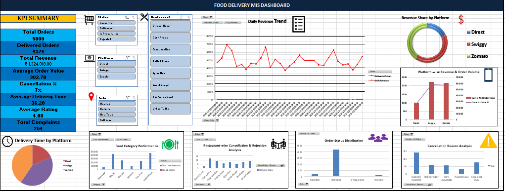

# Food-Delivery-MIS-Dashboard
Excel-based Food Delivery MIS Dashboard with KPI reporting and business analysis

## Project Overview
An Excel-based Management Information System (MIS) dashboard created to analyse food delivery operations and business performance using a simulated dataset of 5,000 orders.

## Tools Used
- Microsoft Excel
- PivotTables and PivotCharts
- Excel formulas
- Slicers
- KPI reporting and dashboard visualisation

## Key Analysis
- Total orders and delivered orders
- Revenue and average order value
- Platform-wise performance (Swiggy, Zomato and Direct)
- Restaurant-wise revenue and performance
- Food category analysis
- Daily revenue trends
- Order status and cancellation analysis
- Platform-wise delivery time

## Key Features
- Interactive dashboard with slicers
- KPI summary
- Business performance charts
- Operational and cancellation insights

## Dataset
This project uses simulated food delivery order data for learning and portfolio demonstration. It is not actual company data.

## Project File
Download the Excel workbook from this repository to explore the analysis and interactive dashboard.

---

## 📊 Dashboard Preview

Here is a preview of my Food Delivery MIS Dashboard, showcasing the key performance indicators and interactive visualizations used to analyse food delivery operations.

> **DISCLAIMER:** The order dataset used in this project is simulated and was created solely for learning and demonstration purposes. It does not represent actual customer or company data.
